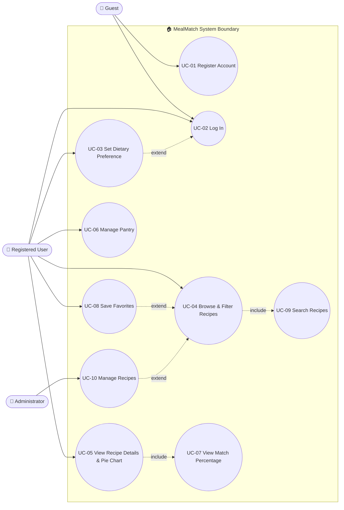
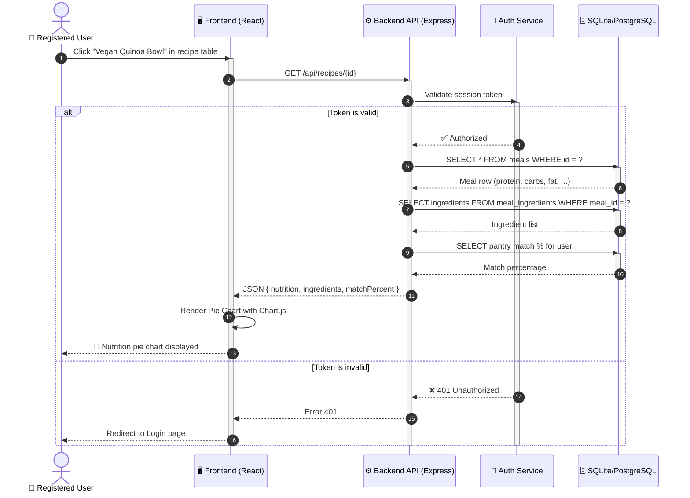
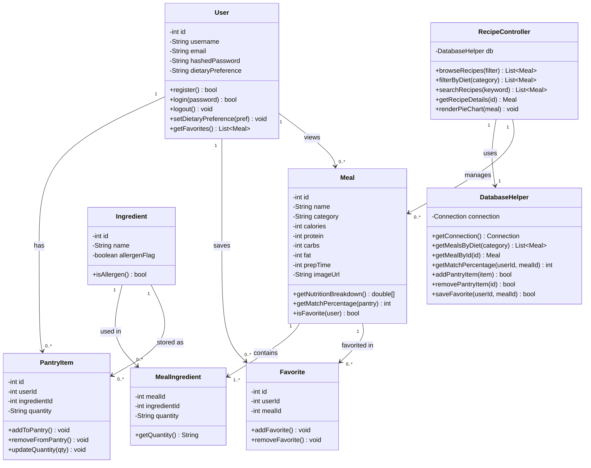

# UML Diagrams for MealMatch

This document contains three UML diagrams for the MealMatch application: a Use-Case diagram, a Sequence diagram, and a Class diagram. Each diagram is rendered directly on GitHub using Mermaid syntax.

---

## 1. Use-Case Diagram

### Use Case Descriptions

| Use Case ID | Name | Primary Actor | Description |
| :--- | :--- | :--- | :--- |
| UC-01 | Register Account | Guest | A new visitor creates an account with a username, email, and password. |
| UC-02 | Log In | Registered User | A user enters credentials to access their personalized dashboard. |
| UC-03 | Set Dietary Preference | Registered User | A user picks or updates their diet (Vegetarian, Vegan, Gluten-Free, or None). |
| UC-04 | Browse & Filter Recipes | Registered User | A user views all recipes and filters them by dietary category. |
| UC-05 | View Recipe Details & Pie Chart | Registered User | A user clicks a recipe to see its full nutritional breakdown rendered as a Pie Chart. |
| UC-06 | Manage Pantry | Registered User | A user adds, views, or removes ingredients from their personal pantry. |
| UC-07 | View Match Percentage | Registered User | The system calculates how well each recipe matches the user's pantry. |
| UC-08 | Save Favorites | Registered User | A user marks recipes as favorites for quick access later. |
| UC-09 | Search Recipes | Registered User | A user searches recipes by name or ingredient. |
| UC-10 | Manage Recipes | Administrator | An admin adds, edits, or removes recipes and ingredients from the database. |

### Include & Extend Relationships

- **UC-04 (Browse & Filter Recipes)** `<<include>>` **UC-09 (Search Recipes)** — searching is always available during browsing.
- **UC-05 (View Recipe Details)** `<<include>>` **UC-07 (View Match Percentage)** — every detail view shows the match percentage.
- **UC-08 (Save Favorites)** `<<extend>>` **UC-04 (Browse Recipes)** — saving a favorite is an optional action triggered while browsing.
- **UC-03 (Set Dietary Preference)** `<<extend>>` **UC-02 (Log In)** — users can optionally set their diet right after logging in.
- **UC-10 (Manage Recipes)** `<<extend>>` **UC-04 (Browse Recipes)** — admin actions extend the browsing use case.

### Diagram

---

## 2. Sequence Diagram

**Chosen Use Case:** UC-05 — View Recipe Details & Nutrition Pie Chart (the core "visual connection" feature of MealMatch).

**Description:** The user clicks a recipe in the UI, which triggers a request to the backend API. The API validates the session, then queries the database for the recipe, its ingredients, and the pantry match percentage. If the session is valid, the UI renders a pie chart; if not, the user is redirected to log in. The `alt` fragment shows these two possible paths.

---

## 3. Class Diagram

### Class Descriptions

| Class | Responsibility |
| :--- | :--- |
| User | Represents a registered user. Handles authentication, dietary preference, and owns their pantry and favorites. |
| Meal | Represents a recipe with nutritional data. Provides methods to compute nutrition breakdowns and match percentages. |
| Ingredient | Represents a single ingredient with allergen info. |
| MealIngredient | Junction class linking meals to ingredients (many-to-many), with quantity details. |
| PantryItem | Represents a single item in a user's pantry. |
| Favorite | Represents a saved recipe for a user. |
| RecipeController | Handles the UI logic — browse, filter, search, and trigger chart rendering. |
| DatabaseHelper | Handles all direct database communication via JDBC/SQL queries. |

### Relationships & Cardinality

| Relationship | Cardinality | Description |
| :--- | :--- | :--- |
| User → PantryItem | 1 : 0..* | A user can have many pantry items (or none). |
| User → Favorite | 1 : 0..* | A user can save many favorites. |
| User → Meal (views) | 1 : 0..* | A user can view many recipes. |
| Meal → MealIngredient | 1 : 1..* | Every meal must have at least one ingredient. |
| Ingredient → MealIngredient | 1 : 0..* | An ingredient can appear in zero or many meals. |
| Ingredient → PantryItem | 1 : 0..* | An ingredient can be in many users' pantries. |
| Meal → Favorite | 1 : 0..* | A meal can be favorited by many users. |
| RecipeController → DatabaseHelper | 1 : 1 | The controller has exactly one database helper. |
| RecipeController → Meal | 1 : 0..* | The controller manages many meals. |
